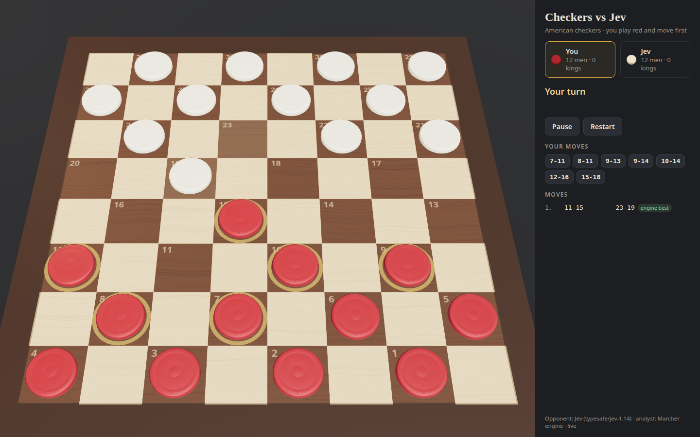

# Checkers vs Jev

A 3D American checkers game in the browser. You play red against **Jev**, which chooses every opponent move. Before each Jev decision, the **Marcher** search engine evaluates every legal move. Jev gets all legal moves, each labelled with its evaluation, and picks one. The server never swaps in a move of its own.



## Run it

You need Node 22+ and pnpm. The OpenRouter key is read **only on the server** from the environment. It is never sent to the browser.

```bash
pnpm install
export OPENROUTER_API_KEY=sk-or-...        # server-side only
pnpm build                                  # builds the client into dist/
pnpm start                                  # serves dist/ and the API on http://localhost:3000
```

For development, run `pnpm dev:server` and `pnpm dev:client` (Vite on :5173 proxies `/api` to :3000).

## How a turn works

1. You make a move on the board, either by clicking pieces in the 3D view or with the keyboard via the "Your moves" list. The client shows it immediately and sends it to the server, which validates it.
2. The server starts one cancellable AI job. Marcher (WASM, in a worker thread) scores every legal reply within `ENGINE_BUDGET_MS`.
3. The server calls the Decisions API (`POST /api/alpha/decisions`, model `JEV_MODEL`) with one *choice* question. Each legal move is an option, annotated with Marcher's label: "best move", "about equal", "worse by about 1.5 men", "wins by force", and so on.
4. Jev's choice is checked against the legal moves and committed. The client animates it from the snapshot it receives over server-sent events.
5. If only one move is legal, it is played as *forced* without calling Jev. If Jev refuses, times out after one retry, or returns an unknown move, the game shows **Jev unavailable** with **Retry**. No substitute move is made.

Pause cancels an in-flight AI job; Resume starts a fresh one. Restart, which asks for confirmation, and Play again after a finished game invalidate any late result through a job-id and generation check. Each history entry for Jev's moves is tagged *engine best*, *lower-rated*, *forced* or *unanalyzed*.

## Measured (9 Nov 2026, live Jev `typesafe/jev-1.14`)

Two complete self-play games against a random-move "human" (`npx tsx scripts/selfplay.ts 2`): Jev won both, after 42 and 46 plies. Over 29 non-forced decisions, AI latency was p50 2.2 s, p95 2.8 s and max 4.2 s, against the spec's 5 s p95 target. Jev's choice matched Marcher's top score in 26 of 29 decisions. Jev costs about $0.00003 per call.

## Tests

| Command | What it covers |
|---|---|
| `pnpm test` | Rules (perft 1–8 equals the published reference, captures, promotion, draws), lifecycle reducer, opponent, Jev client, click-selection and display model |
| `pnpm test:integration` | Marcher equivalence on 300 random positions, ranking and cancellation, plus the HTTP API: ownership, stale versions, idempotency, pause and restart races, AI errors, SSE, key secrecy |
| `pnpm e2e` | Playwright against the production build with a fake Decisions server (`tests/e2e/fake-openrouter.mjs`): start, canvas play, illegal clicks, keyboard, pause mid-decision, restart confirm, Jev failure and Retry, refresh restore, a full game to the result and Play again |
| `pnpm lint` | ESLint (typescript-eslint and React hooks rules), zero warnings allowed |
| `pnpm verify` | Every gate above in CI order, plus the production build and a dependency audit |

## CI/CD and release

`pnpm verify` runs every gate in the same order as CI: lint, type check, unit tests, integration tests, the production build, a production dependency audit (high severity and above) and the browser end-to-end suite. `pnpm verify --skip-e2e` is the quick local version.

**CI.** The repository is `github.com/ryamgoh/checkers-vs-jev` (private). Once turned on (see below), GitHub Actions runs the same gates on every pull request and every push to `main`, as four parallel jobs:

- quality: lint, types, unit and integration tests;
- build and audit: also uploads `dist/`;
- browser end-to-end tests: Playwright against the fake Decisions server, so CI never needs the OpenRouter key;
- image: builds the Dockerfile, boots the container and checks `/api/health`, `/` and `/manus-routes.json`.

Dependabot opens weekly, grouped updates for npm packages, Actions and the Docker base image.

**Turn on GitHub Actions (one-time, repository owner).** The workflow is stored as a template in `ci/github-actions/ci.yml`. GitHub does not let the Manus GitHub App create or change files under `.github/workflows/`, so the owner moves it there once:

1. On GitHub, open `ci/github-actions/ci.yml` and click the pencil icon (Edit).
2. Change the file name at the top to `.github/workflows/ci.yml`, then commit to `main`.

Or, from a clone authenticated as you: `git mv ci/github-actions/ci.yml .github/workflows/ci.yml && git commit -m "Turn on CI" && git push`.

The first run starts immediately and appears under the repository's **Actions** tab. Manus pushes keep working afterwards, as long as they don't touch `.github/workflows/`. Change the workflow itself on GitHub, or let Dependabot update it.

**Delivery.** The app is hosted on Manus. The Dockerfile builds the client and runs the Fastify server, which serves the client and the API on one origin. The platform waits for `GET /api/health` before routing traffic to a new version. `OPENROUTER_API_KEY` comes from the project's secrets at runtime, never from the image or the repository. Each commit accepted on `main` is a Manus checkpoint (a saved version). Publishing deploys a checkpoint, and Version history can roll back to an earlier one.

**Releasing.** Commit, then run `pnpm release`. It refuses a dirty working tree or a branch that is missing commits from `origin/main`, runs `pnpm verify` on exactly that commit, and pushes to `main` only if every gate passes. Publish the new checkpoint from the Manus Dashboard, or turn on auto-publish there to deploy every checkpoint. Day to day, the usual flow is a pull request that merges after CI passes; merging to `main` records a checkpoint. Making the CI checks *required* on `main` needs branch protection, which GitHub offers on private repositories only with a paid plan.

**Hosting mode.** Autoscale (the default), which costs nothing while idle. Games live in server memory, so if the platform sleeps an idle instance, adds a second one or publishes a new version, a game in progress can be lost; the client then offers a new game. For always-available games, switch to Reserved (a single always-on instance, usage-billed) in the Dashboard's hosting settings, or move game state to a shared store.

## Configuration (environment)

| Variable | Default | Purpose |
|---|---|---|
| `OPENROUTER_API_KEY` | — | Required for Jev. Without it, Start is disabled with an explanation |
| `JEV_MODEL` | `typesafe/jev-1.14` | Decisions model |
| `JEV_TIMEOUT_MS` | `5000` | Per-call timeout (one retry for transient failures) |
| `JEV_MAX_CALLS_PER_DAY` | `2000` | Spend ceiling |
| `ENGINE_BUDGET_MS` | `1500` | Marcher analysis budget per AI turn |
| `GAME_TTL_MS` | `7200000` | Idle games are discarded after this |
| `PORT`, `HOST`, `STATIC_DIR` | `3000`, `0.0.0.0`, `dist` in production | Server |

## API

All writes are JSON and owned by an HttpOnly cookie. Over HTTPS the cookie is `SameSite=None; Secure`, so it also works inside the Manus Preview iframe; on plain-HTTP localhost it is `SameSite=Lax`. Cross-site writes are refused using `Sec-Fetch-Site`, falling back to an Origin check against `Host` and `X-Forwarded-Host`.

- `POST /api/games` creates a game in the *ready* state and returns a snapshot.
- `GET /api/games/:id` returns the current snapshot.
- `GET /api/games/:id/events` streams server-sent snapshots.
- `POST /api/games/:id/commands` takes `{ commandId, expectedVersion, command }`, where `command.type` is one of `start | move | pause | resume | restart | retry-ai`. A stale version returns 409 with the latest snapshot; a repeated `commandId` returns the original response.
- `GET /api/health` reports whether Jev is configured and which model is in use. It never includes the key.

## Layout

`shared/rules` holds the rules core (standard 1–32 numbering, full jump paths). `shared/contracts` holds the Zod API schemas. `server/` contains the lifecycle reducer and store, the Jev client, the opponent, Marcher (vendored WASM, MIT, SHA-256 pinned) and Fastify. `client/` contains the React and three.js scene, the zustand store and the UI. `scripts/` has `selfplay.ts`, `screenshots.mjs` and diagnostics.

## Known limits

- **"Optimal" means practically optimal.** Marcher is a strong heuristic search, not an endgame-database solver, and Jev occasionally picks a lower-rated move (3 of 29 in the measured games). Those moves are tagged in the history.
- Games live in server memory: a server restart ends them, and the client then offers a new game.
- Publishing a new version restarts the server, which ends games in progress.
- On Autoscale the server gets CPU only while a request is open. The client's live event stream (`/events`) keeps a request open during Jev's turn, so analysis and Jev's reply run at full speed. Measured on the published site with the stream open: 1.9–2.4 s per reply, with engine analysis. Without it (polling only), one reply took 16 s and missed the analysis. Reserved hosting removes this dependency. `node scripts/diag/sse-probe.mjs <url>` reproduces the measurement.
- Headless browsers without a GPU render at about 1 fps. The board uses on-demand rendering, so it draws nothing while idle and animates at full frame rate on real hardware.
