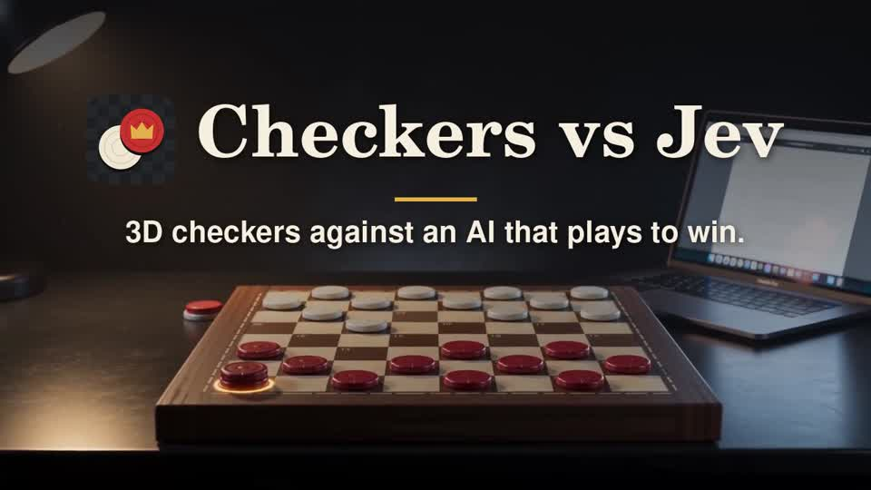

# Checkers vs Jev — 30-second promo

[](checkers-vs-jev-promo-30s.mp4)

**[checkers-vs-jev-promo-30s.mp4](checkers-vs-jev-promo-30s.mp4)** is a 16:9 promo (1280×720, 24 fps, 30.0 s, AAC stereo at about -14 LUFS). It is cut from two 15-second clips that were generated at the same time with Seedance 2.0 Fast. Both clips share the same palette, lighting and original score. All on-screen text was added in post.

| Time | What you see | Text |
|---|---|---|
| 0:00–0:05 | A red checker lands on a walnut board, then a slide along the two armies | — |
| 0:05–0:11 | A player clicks a piece in the real game UI, it moves, and the panel shows "Jev analyzing…" | **Click. Move.** |
| 0:11–0:15 | The same move is played on the physical board | — |
| 0:15–0:19 | A cream piece moves on its own, and the game tags Jev's reply *engine best* | **Jev answers in seconds.** |
| 0:19–0:25 | A red double jump, then a king is crowned | **Strike back.** |
| 0:25–0:30 | A wide hero shot of the board and laptop, then the end card | **Checkers vs Jev** — *3D checkers against an AI that plays to win.* |

## Files

| Path | Contents |
|---|---|
| `checkers-vs-jev-promo-30s.mp4` | The finished promo |
| `clips/clip-1-your-move.mp4`, `clips/clip-2-jev-replies.mp4` | The raw 15 s clips with their synchronized sound effects (no music, no text) |
| `music/score-original.mp3` | The full original instrumental (62.7 s, about 100 BPM). The promo uses 9.73–36.73 s, with a 1 s crossfade into the natural ending at 56.6–60.6 s |
| `source/make_gfx.py` | Renders the transparent text overlays and the end card into `source/overlays/` (needs Pillow) |
| `source/assemble.sh` | Rebuilds the promo with FFmpeg: concatenates the clips, overlays the text, and mixes the score under the sound effects |
| `poster.jpg` | A frame from the end card |

Rebuild the promo with:

```bash
python3 docs/promo/source/make_gfx.py      # only if you change the text
bash docs/promo/source/assemble.sh         # writes docs/promo/checkers-vs-jev-promo-30s.mp4
```

The text timings are the `fade=...:st=` values in `assemble.sh`. The music level is `volume=0.55`.

## Notes

- The game screens in the clips were generated from the screenshots in `docs/screenshots/` (version `62f8c56`). Some of the tiny side-panel text is garbled, for example "Mings" instead of "kings". You can only see it if you zoom in on a still frame.
- The fonts are C059 Bold for the title and Nimbus Sans Bold for the other text (URW base35).
